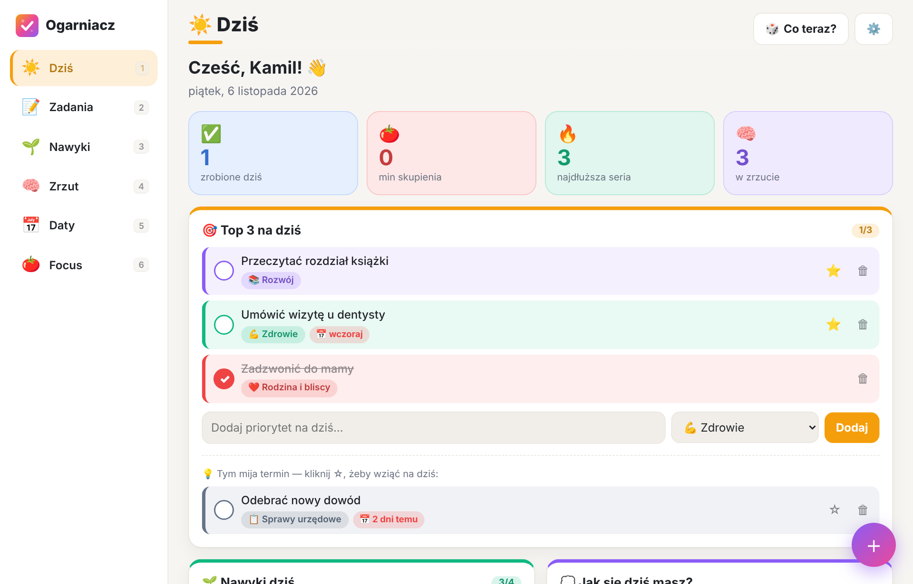
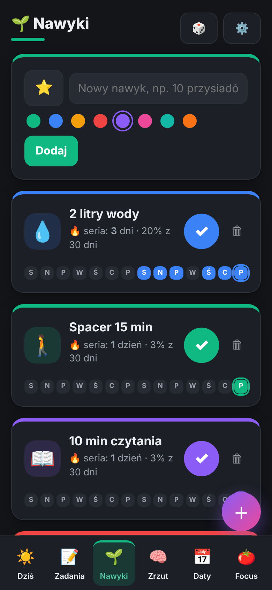

# ✨ Ogarniacz — ogarnij życie

Kolorowa, prosta aplikacja do ogarniania **spraw osobistych**: zadań, nawyków, ważnych dat, myśli z głowy i skupienia.
Zaprojektowana z myślą o mózgu z ADHD: **każdy moduł ma swój kolor i emoji**, listy są krótkie, a za zrobione rzeczy jest konfetti 🎉.



---

## 🗺️ Mapa aplikacji — zapamiętaj kolory

| Klawisz | Moduł | Kolor | Do czego służy |
|:---:|---|---|---|
| `1` | ☀️ **Dziś** | 🟧 pomarańczowy | Pulpit dnia: **Top 3 priorytety**, nawyki, nastrój i energia, nadchodzące daty |
| `2` | 📝 **Zadania** | 🟦 niebieski | Wszystkie zadania w kolorowych **obszarach życia** (Zdrowie, Rodzina, Finanse, Dom…) |
| `3` | 🌱 **Nawyki** | 🟩 zielony | Kropki z 3 tygodni + seria 🔥. Odhaczasz jednym kliknięciem |
| `4` | 🧠 **Zrzut** | 🟪 fioletowy | Wyrzuć myśl z głowy w 2 sekundy, posortuj później |
| `5` | 📅 **Daty** | 🩷 różowy | Urodziny, OC, przegląd auta, rachunki — z odliczaniem dni |
| `6` | 🍅 **Focus** | 🟥 czerwony | Minutnik do pracy w skupieniu (5/15/25/45 min) |
| — | ⚙️ **Ustawienia** | ⬜ szary | Imię, motyw, obszary życia, kopia zapasowa |

### ⚡ Supermoce na ADHD

- **`N`** z każdego miejsca (albo różowy przycisk **＋**) → szybki zrzut myśli. Zero decyzji, tylko zapis.
- **🎲 Co teraz?** — gdy nie wiesz, od czego zacząć, aplikacja losuje za Ciebie (najpierw z Top 3) i od razu odpala Focus.
- **⭐ Top 3** — maksymalnie trzy priorytety na dziś. Przy czwartym dostaniesz delikatne przypomnienie 😉
- **💡 Podpowiedzi** — zadania z mijającym terminem same pokazują się na ekranie „Dziś”.
- **🎉 Konfetti** za każde zadanie i duże konfetti, gdy zamkniesz całe Top 3.
- **⏳ Licznik w karcie przeglądarki** podczas Focusa — widzisz czas, nawet gdy jesteś w innej karcie.
- **↩️ Cofnij** po usunięciu zadania lub myśli — bez stresu.

<p align="center"></p>

---

## 🚀 Jak uruchomić

### Opcja A — w internecie (GitHub Pages, za darmo)

1. Na GitHubie: **Settings → Pages → Build and deployment → Source: GitHub Actions**.
2. Każdy push na gałąź `main` publikuje aplikację automatycznie (workflow `.github/workflows/pages.yml`).
3. Adres będzie wyglądał tak: `https://<twoj-login>.github.io/<nazwa-repo>/`

> 🔒 Kod aplikacji jest publiczny, jeśli repo jest publiczne — ale **Twoje dane nie**. Zadania, nawyki itd. zapisują się wyłącznie w przeglądarce na Twoim urządzeniu.

### Opcja B — lokalnie

```bash
python3 -m http.server 8000
# otwórz http://localhost:8000
```

### 📱 Na telefon

Otwórz adres w telefonie → **„Dodaj do ekranu początkowego”**. Ogarniacz działa jak zwykła aplikacja, także **bez internetu**.

---

## 💾 Gdzie są moje dane?

- Wszystko zapisuje się w **localStorage** przeglądarki — bez kont, bez serwera, bez śledzenia.
- Każde urządzenie ma **osobne dane**. Do przenoszenia i backupu: **⚙️ Ustawienia → Pobierz kopię / Wczytaj kopię** (plik `.json`).
- Gdy masz już trochę zadań, a kopii nie było od tygodnia, „Dziś” przypomni Ci o niej żółtym paskiem.

---

## 🧱 Budowa (dla ciekawych)

Czysty HTML + CSS + JavaScript (moduły ES). **Zero zależności, zero budowania** — edytujesz plik i odświeżasz.

```
index.html              ← szkielet strony
css/styles.css          ← wygląd (jasny + ciemny motyw)
js/app.js               ← routing, zdarzenia, skróty klawiszowe
js/store.js             ← dane w localStorage, import/eksport
js/global.js            ← akcje wspólne (zadania, nawyki, zrzut, „Co teraz?”)
js/ui.js                ← powiadomienia, konfetti, okna, dźwięk
js/utils.js             ← daty, odmiana polska, serie nawyków
js/views/*.js           ← moduły: dzis, zadania, nawyki, zrzut, daty, focus, ustawienia
sw.js                   ← tryb offline
manifest.webmanifest    ← instalacja jako aplikacja
```

---

## 🛣️ Pomysły na dalej

- [ ] Edycja tytułu zadania i zmiana obszaru
- [ ] Synchronizacja między telefonem a komputerem
- [ ] Przypomnienia push o ważnych datach
- [ ] Zadania cykliczne (np. „co tydzień: śmieci”)
- [ ] Prosty budżet domowy w obszarze 💰 Finanse
- [ ] Tygodniowe podsumowanie: nastrój × energia × nawyki na wykresie
